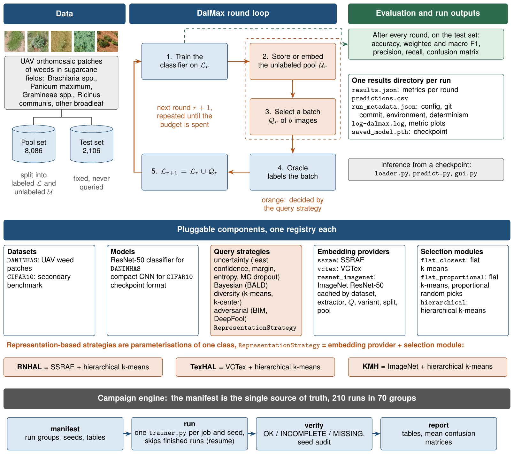

# DalMax

**Deep Active Learning Laboratory for UAV Weed Recognition**


[](https://github.com/MarioCarvalhoBr/dalmax-framework-deep-active-learning-python/actions/workflows/ci.yml)
[](https://colab.research.google.com/github/MarioCarvalhoBr/dalmax-framework-deep-active-learning-python/blob/main/notebooks/colab_runbook.ipynb)

DalMax is a PyTorch framework for **pool-based deep active learning on image
classification**, built for a PhD project (UFMS, Brazil) on weed recognition in
UAV images of sugarcane fields. A query strategy, an image representation and a
batch-selection module are interchangeable components of one experiment loop, so
that a new method is a registry entry or a parameters file, not a new script. It
supports the three papers of the thesis:

1. **A budget-aware benchmark of 13 strategies**: 12 classical strategies
   (uncertainty, Bayesian, diversity and adversarial) plus **KMH** (hierarchical
   k-means over ImageNet ResNet-50 features), at three query budgets, against a
   full-supervision upper bound.
2. **TexHAL**: VCTex color-texture representation + hierarchical k-means batch selection.
3. **RNHAL** (Randomized Network-guided Hierarchical Active Learning): SSRAE
   randomized-network spatio-spectral representation + hierarchical k-means batch
   selection, the main contribution.



*Figure: the DalMax framework. Data and the active learning round loop (top),
the registries of interchangeable components (middle) and the campaign engine
that runs, verifies and reports every experiment (bottom).*

## Table of contents

- [Overview](#overview)
- [Implemented query strategies](#implemented-query-strategies)
- [Installation](#installation)
- [Datasets](#datasets)
- [Run an experiment](#run-an-experiment)
- [The campaign](#the-campaign)
- [Inference tools](#inference-tools)
- [Params JSON schema](#params-json-schema)
- [Results directory convention](#results-directory-convention)
- [Execution environments](#execution-environments)
- [Development](#development)
- [Repository layout](#repository-layout)
- [Roadmap](#roadmap)
- [License](#license) / [Citing](#citing) / [Contact](#contact) / [Acknowledgements](#acknowledgements)

## Overview

DalMax implements and compares acquisition (query) strategies for training a deep
classifier (ResNet-50) under a limited annotation budget, on a domain dataset
(`daninhas_full`, UAV weed image patches, five classes) and on CIFAR-10 as a
secondary benchmark.

In every round the loop (see the figure) trains the classifier on the labeled set,
scores or embeds the unlabeled pool, selects a batch with the query strategy, lets
the oracle label it, adds it to the labeled set and evaluates on a fixed test set
(accuracy, weighted and macro precision/recall/F1, confusion matrix). Every
dataset, model, strategy, embedding provider and selection module lives in a plain
dict registry (`DATASET_REGISTRY`, `MODEL_REGISTRY`, `STRATEGY_REGISTRY`,
`EMBEDDING_REGISTRY`, `SELECTION_REGISTRY`); unknown names fail with an explicit
error instead of a silent fallback.

**RNHAL** combines two stages:

1. A **randomized-network spatio-spectral representation module**, instantiated
   through the **SSRAE** formulation (code in `dalmax/tools/SSRAE/`). For an image
   `x`, closed-form randomized autoencoders produce a spatial signature per channel
   (`Θ_R`, `Θ_G`, `Θ_B`) and a spectral signature per adjacent channel pair
   (`Ω_RG`, `Ω_GB`, `Ω_BR`); the embedding is conceptually their concatenation
   `Φ(x) = [Θ_R, Θ_G, Θ_B, Ω_RG, Ω_GB, Ω_BR]`. **Implementation note**: the vector
   produced by `dalmax/tools/SSRAE/extractor.py` is row-interleaved, not two
   contiguous halves, so naive slicing such as `emb[:len(emb)//2]` does **not**
   recover the spatial-only signatures; see
   [`.specs/experiments/ablation-study.md`](.specs/experiments/ablation-study.md) §6.1 for
   the slicing the representation ablation uses.
2. A **hierarchical k-means batch selection mechanism** (`dalmax/tools/SSL/`) that
   recursively partitions the embedding space of the unlabeled pool and samples the
   query batch across the induced hierarchy, aiming for batches that are both
   informative and structurally diverse rather than redundant in visually dense
   regions.

**TexHAL** and **KMH** reuse the same hierarchical selection with a different
representation (VCTex, ImageNet ResNet-50). They are not separate classes: RNHAL,
TexHAL and KMH are three parameterisations of the generic
`RepresentationStrategy` (an embedding provider plus a selection module), so the
ablations of papers 2 and 3 differ from the full methods only in the params JSON.

The experiment protocol and the ablation design are in
[`.specs/experiments/experimental-protocol.md`](.specs/experiments/experimental-protocol.md)
and [`.specs/experiments/ablation-study.md`](.specs/experiments/ablation-study.md); the
architecture and the project status are in [`.specs/00-overview.md`](.specs/00-overview.md)
and [`.specs/README.md`](.specs/README.md) (the specs are the source of truth).

## Implemented query strategies

These are the exact `--strategy_name` choices exposed by `tools/trainer.py`.

**Uncertainty-based**
- **`RandomSampling`**: random selection (baseline).
- **`LeastConfidence`**: samples where the model is least confident [1].
- **`MarginSampling`**: samples with the smallest margin between the two most likely classes [2].
- **`EntropySampling`**: samples with the highest prediction entropy [3].
- **`LeastConfidenceDropout`, `MarginSamplingDropout`, `EntropySamplingDropout`**:
  the same criteria estimated with `n_drop` stochastic (MC-dropout) forward passes [4].

**Bayesian**
- **`BALDDropout`**: Bayesian Active Learning by Disagreement, epistemic uncertainty via MC dropout [4].

**Diversity**
- **`KMeansSampling`**: samples representative of feature-space clusters [5].
- **`KCenterGreedy`**: core-set selection minimizing the covering radius [5].

**Adversarial**
- **`AdversarialBIM`**: samples closest to the decision boundary, via the Basic Iterative Method [6].
- **`AdversarialDeepFool`**: samples with the smallest adversarial margin, via DeepFool [6].

**Representation-based (RNHAL, TexHAL, KMH family)**
- **`RepresentationStrategy`**: the generic strategy, driven by the params JSON's
  `embedding`/`selection` blocks (see [Params JSON schema](#params-json-schema)).
  RNHAL is `ssrae` + `hierarchical`, TexHAL is `vctex` + `hierarchical`, KMH is
  `resnet_imagenet` + `hierarchical`.
- Four fixed presets of it, kept for earlier scripts (they pin `Q` to the legacy value
  and ignore `embedding.q`): **`SSRAEKmeansSampling`** and **`VCTexKmeansSampling`**
  (flat k-means, `flat_closest`), **`SSRAEKmeansHCSampling`** and
  **`VCTexKmeansHCSampling`** (hierarchical k-means).

**Upper bound (not active learning)**
- **`FullSupervised`**: trains once on the entire pool (every label known at
  initialization, requires `--n_round 0`) and evaluates on the test set; it never
  queries. It is the reference "maximum achievable" score of the benchmark.

Known limitation of the first campaign execution: the ResNet-50 head had no dropout layer, so the MC-dropout
strategies and `BALDDropout` were degenerate, `KMeansSampling`/`KCenterGreedy` used an
untrained embedding layer, and `AdversarialBIM` broke its distance ties in pool order
(KI-41, KI-42, KI-45 in [`.specs/quality/known-issues.md`](.specs/quality/known-issues.md)). All three are
fixed in code since 2026-11-11 (ADR 0014; optional params block `"model_args": {"dropout_p": ...}` for the
MC-dropout strategies) and the 63 affected runs are prepared for re-execution as the campaign parts
`paper1_rerun_a` / `paper1_rerun_b` (`COLAB_RUNBOOK.md` section 6d), not executed yet.

## Installation

DalMax is **Poetry-only** (the pip/`requirements.txt` path was retired), on every
machine: dev notebook, lab machine or Colab. See [ADR 0001](.specs/adr/0001-adopt-poetry.md).

1. **Prerequisites**: Python **3.10 to 3.12** (upper-bounded by the `torch==2.5.0` pin;
   check with `python3 --version`) and `git`.
2. **Install Poetry**, preferably via [`pipx`](https://pipx.pypa.io/):

   ```bash
   sudo apt install pipx
   pipx ensurepath
   pipx install poetry
   poetry --version   # developed against Poetry 2.x
   ```

   or with the official installer: `curl -sSL https://install.python-poetry.org | python3 -`.
3. **Clone and install**:

   ```bash
   git clone https://github.com/MarioCarvalhoBr/dalmax-framework-deep-active-learning-python.git
   cd dalmax-framework-deep-active-learning-python
   poetry install
   ```

`poetry install` resolves `pyproject.toml`/`poetry.lock` and creates an in-project
virtualenv at `./.venv`. On Linux x86_64 it installs `torch==2.5.0` from the CUDA 12.4
wheel index pinned in the lockfile; it also works on CPU-only machines (a large
download, about 2.5 GB). Dependency versions are exact-pinned for reproducibility.
Use `poetry run <cmd>` for every command in this README (or `poetry env activate`,
or `source .venv/bin/activate`). No GPU is required for development, smoke tests or
CPU-only strategies.

## Datasets

### daninhas_full (primary)

UAV weed image patches (10,192 images: 8,086 in the pool, 2,106 in the fixed test
set), five classes, `train/`/`test/` split:

```
DATA/
    daninhas_full/
        train/  test/
            DATASET_BRACHIARIA/  DATASET_COLONIAO/  DATASET_GRAMINEA/
            DATASET_MAMONA/      DATASET_OUTRAS_FOLHAS_LARGAS/
```

(`train/` and `test/` each hold the five class folders.) `DATA/` is immutable,
read-only input and is not distributed with this repository; see
[`.specs/research-rules/dataset-protocol.md`](.specs/research-rules/dataset-protocol.md)
for the class definitions and imbalance notes.

### CIFAR-10 (secondary benchmark)

```bash
mkdir -p DATA
# Download DATA_CIFAR10.zip:
# https://drive.google.com/file/d/1xNQS9QngkoxOPyQhtG6PzbAr9b83Bmk7/view?usp=sharing
unzip DATA_CIFAR10.zip -d DATA
```

Expected layout: `DATA/DATA_CIFAR10/{train,test}/{0,1,...,9}/`.

## Run an experiment

Entry point: `tools/trainer.py`, a thin shim over `dalmax.cli.main()`. Example
(RNHAL hierarchical strategy on the weed dataset):

```bash
poetry run python tools/trainer.py \
    --dir_results results/scratch/ \
    --params_json files_config/campaign/params_paper1.json \
    --dataset_name DANINHAS \
    --strategy_name SSRAEKmeansHCSampling \
    --n_query 100 --n_init_labeled 100 --n_round 8 \
    --seed 1 --device cuda
```

CLI arguments: `--dir_results`, `--params_json`, `--seed`, `--n_init_labeled`,
`--n_query`, `--n_round`, `--dataset_name {CIFAR10,DANINHAS}`, `--strategy_name` (any
name of the previous section), plus:

- `--device {auto,cuda,cpu}` (default `auto`, resolving to `cuda` iff available).
  Pass `--device cuda` explicitly on GPU machines instead of relying on `auto`.
- `--embedding_variant {full,spatial,spectral}` (default: no override): overrides the
  params JSON's `embedding.variant` for the SSRAE extractor, so one params JSON
  serves the three representation-ablation variants.

The generic strategy reads its `(extractor, selection method)` pair from the params
JSON, e.g. an SSRAE `spatial` variant, a `resnet_imagenet` embedding with
hierarchical selection or SSRAE with `flat_proportional` selection:

```bash
poetry run python tools/trainer.py --dir_results results/scratch/ \
    --params_json files_config/ablations/rnhal/rep_spatial.json \
    --dataset_name DANINHAS --strategy_name RepresentationStrategy \
    --n_query 100 --n_init_labeled 100 --n_round 8 --seed 1 --device cuda
```

Reproducibility: the params JSON, the CLI arguments, the seed and the git commit
fully determine a run (`run_metadata.json` records them). Seeding is centralised in
`dalmax/seeding.py`; on CPU results are bit-identical, on GPU determinism is
best-effort (the `determinism` block of `run_metadata.json` lists any op without a
deterministic kernel), so report seed-averaged numbers.

## The campaign

Everything the three papers need runs from ONE manifest,
`files_config/campaign/manifest.json` (222 runs in 74 run groups, all executed, seeds 1 to 3; the 63 runs of the
seven paper-1 baselines fixed on 2026-11-11 are prepared for re-execution as parts `paper1_rerun_a`/`paper1_rerun_b`, ADR 0014;
configurations shared by several papers run once and are aliased), driven by the
engine `dalmax/campaign.py`. See
[`.specs/experiments/campaign.md`](.specs/experiments/campaign.md) and ADR 0008/0009/0010.

```bash
make campaign-list                 # job table + run counts per part
make campaign-run PART=all         # sequential, skip-existing: re-run the same command to resume
make campaign-verify               # OK/INCOMPLETE/MISSING per job + seed audit
make campaign-report               # tables + mean confusion matrices -> docs/results/campaign/
make campaign-smoke                # CPU micro campaign (skips the two adversarial baselines)
```

Variables: `PART=all|paper1|upper_bound|rnhal|texhal|texhal_q17` (comma-separated
allowed), `MICRO=1` (micro manifest on CPU, results in `results/smoke_campaign/`),
`MANIFEST=path` (any other manifest, overrides `MICRO`; e.g. the KI-43 control:
`make campaign-run MANIFEST=files_config/campaign/manifest_control_ki43.json PART=control`),
`SEEDS=1`, `EXCLUDE=A,B`, `DEVICE=cuda|cpu|auto` and `RUN_ARGS='--dry-run'`.
`make campaign-manifest` regenerates the committed manifests from
`scripts/campaign/build_manifest.py`. The campaign was executed on Google Colab
Pro (222 of 222 runs OK, seed audit passed); the results are tabulated in the
campaign spec.

Step-by-step operator guides: **[`LAB_RUNBOOK.md`](LAB_RUNBOOK.md)** (lab machine) and
**[`COLAB_RUNBOOK.md`](COLAB_RUNBOOK.md)** (Colab; the runnable notebook is
[`notebooks/colab_runbook.ipynb`](notebooks/colab_runbook.ipynb)). Environment
checks: `make lab-setup`, `make lab-check`, `make colab-setup`, `make colab-check`,
`make micro-dataset`.

## Inference tools

`trainer.py` writes a self-describing `dalmax-checkpoint` (`saved_model.pth`;
`dalmax/models/checkpoint.py`: weights plus `model_name`/`n_classes`/`class_names`/
`img_size`/provenance), consumed by three tools. All preprocessing is read from the
same code training used, so predictions match what a real run would record. See
[ADR 0006](.specs/adr/0006-checkpoint-format-and-inference-tools.md).

> Checkpoints written before 2026-08-23 (including the early `results/dalmax1/` and
> `results/dalmax2/` runs) contain no weights (a saved class reference, KI-22 in
> [`.specs/quality/known-issues.md`](.specs/quality/known-issues.md)) and cannot be recovered.

**`tools/loader.py`**: inspect a checkpoint (format/version, model, labels, provenance,
parameter counts per module, file size, CPU dummy-forward check; a clear error on a legacy file).

```bash
poetry run python tools/loader.py --model results/campaign/.../saved_model.pth
```

**`tools/predict.py`**: run a checkpoint on one image or a folder (searched recursively).

```bash
poetry run python tools/predict.py --model results/campaign/.../saved_model.pth \
    --image DATA/daninhas_full/test/DATASET_GRAMINEA/some_image.jpg
poetry run python tools/predict.py --model results/campaign/.../saved_model.pth \
    --dir DATA/daninhas_full/test/DATASET_GRAMINEA --out results/predictions/
```

It writes `predictions.csv` (`Image Index,Predicted Class,Confidence,Path`, plus one
probability column per class) and a `<stem>.pred.json` sidecar per image into `--out`
(default: alongside the input); `--device {auto,cpu,cuda}` mirrors `trainer.py`.

**`tools/gui.py`**: a `tkinter` mini-app (load a model, pick images or a folder, see a
results table and per-class probabilities, export the same CSV). Runs on CPU by default;
only `dalmax/inference/gui.py::main()` touches `tkinter`, so the module imports headless.

```bash
poetry run python tools/gui.py
```

## Params JSON schema

Hyperparameters are keyed by dataset name (see `files_config/campaign/params_paper1.json`,
the reference file of the campaign). `dalmax/config/loader.py` reads the schema below.

```json
{
  "DANINHAS": {
    "data_dir": "DATA/daninhas_full/",
    "n_epoch": 10,
    "n_drop": 10,
    "n_classes": 5,
    "train_args": { "batch_size": 256, "num_workers": 4 },
    "test_args": { "batch_size": 256, "num_workers": 4 },
    "optimizer_args": { "lr": 0.05, "momentum": 0.3 },
    "config_kmh": {
      "n_clusters": [600, 200, 100],
      "n_levels": 3,
      "sample_sizes": [30, 15, 2]
    }
  },
  "CIFAR10": {
    "data_dir": "DATA/DATA_CIFAR10/",
    "n_epoch": 20,
    "n_drop": 10,
    "n_classes": 10,
    "train_args": { "batch_size": 64, "num_workers": 1 },
    "test_args": { "batch_size": 1000, "num_workers": 1 },
    "optimizer_args": { "lr": 0.05, "momentum": 0.3 }
  }
}
```

`config_kmh` (hierarchical k-means config, needed only by the `*HCSampling` presets)
sets the clusters per level (`n_clusters`), the number of levels (`n_levels`) and the
samples drawn per level (`sample_sizes`). The CIFAR-10 block is exercised by
`files_config/benchmark/params_df_gpu_*.json`, kept for the tests.

**Optional per-dataset keys**, consumed by `--strategy_name RepresentationStrategy`
(the presets mostly ignore them):

```json
{
  "DANINHAS": {
    "...": "... same required keys as above ...",
    "embedding": { "extractor": "ssrae", "q": 13, "variant": "full" },
    "selection": {
      "method": "hierarchical",
      "hierarchy": { "n_clusters": [600, 200, 100], "n_levels": 3, "sample_sizes": [30, 15, 2] }
    }
  }
}
```

- `embedding.extractor`: `"ssrae"` (default) | `"vctex"` | `"resnet_imagenet"`.
- `embedding.q`: the extractor's hyperparameter: `13` for SSRAE, `[5, 17]` for VCTex,
  `null` for `resnet_imagenet` (fixed 2048-d penultimate layer). Defaulted per extractor
  if omitted; never falls back to SSRAE's `13` for VCTex. TexHAL's canonical config is `17`
  (ADR 0011).
- `embedding.variant`: `"full"` (default) | `"spatial"` | `"spectral"`; SSRAE only, slices
  the cached full embedding and never recomputes it.
- `selection.method`: `"flat_closest"` (flat k-means, closest sample per cluster) |
  `"flat_proportional"` (random picks per cluster, proportional to cluster size,
  cluster count independent of the query budget) | `"hierarchical"` (requires
  `selection.hierarchy`).
- A dataset entry with a legacy `"config_kmh"` and no `"selection"` key is read as
  `selection = {"method": "hierarchical", "hierarchy": config_kmh}`.

Embeddings are cached in `results/cache/embeddings/` under a key built from
`(dataset, extractor, Q, variant, split, pool_hash)`, so a cache is never reused across a
different configuration. The exact `embedding`/`selection` values of each ablation run are in
[`.specs/experiments/ablation-study.md`](.specs/experiments/ablation-study.md) and
`files_config/ablations/README.md`.

## Results directory convention

`trainer.py` writes to:

```
{dir_results}/{dataset_folder}/SEED_{seed}/NQ_{n_query}_NIL_{n_init_labeled}_NR_{n_round}_NE_{n_epoch}/{strategy_name}/
```

containing `results.json` (per-round metrics, written last so its presence marks a
complete run; weighted and macro precision/recall/F1), `predictions.csv`,
`confusion_matrix.pdf`, `accuracy.pdf`/`precision.pdf`/`recall.pdf`/`f1_score.pdf`,
`log-dalmax.log`, `saved_model.pth` (the `dalmax-checkpoint`, see
[Inference tools](#inference-tools)) and `run_metadata.json` (full config snapshot, git
commit, library versions, recorded environment and determinism settings). `results/` is
append-only. See [`.specs/experiments/experimental-protocol.md`](.specs/experiments/experimental-protocol.md).

## Execution environments

DalMax is developed and run across three environments, hardware-agnostic: the GPU
actually used is recorded at runtime in each run's `run_metadata.json`
(`environment.gpus`), never named in code or docs.

1. **Local dev notebook**: no GPU. Coding, CPU smoke tests on tiny subsets, reports.
2. **Lab machine**: one or more GPUs; pull the repo, run the campaign
   (`make campaign-run`), bring results back via git or copy.
3. **Google Colab Pro** (single GPU, session-limited): a hybrid layout (repo, `.venv` and
   dataset on the runtime's local disk, `results/` symlinked to Drive so artifacts survive a
   disconnect) via `make colab-setup` / `make campaign-run`.

Details and decision matrix:
[`.specs/infrastructure/execution-environments.md`](.specs/infrastructure/execution-environments.md);
operator guides: [`LAB_RUNBOOK.md`](LAB_RUNBOOK.md), [`COLAB_RUNBOOK.md`](COLAB_RUNBOOK.md)
and the runnable notebook
[`notebooks/colab_runbook.ipynb`](notebooks/colab_runbook.ipynb)
(badge at the top). Training targets CUDA 12.4 with `torch==2.5.0`/`torchvision==0.20.0`.

## Development

The project uses a Claude Code multi-agent setup for coding sessions: see
[`CLAUDE.md`](CLAUDE.md) (operational guide), [`.claude/`](.claude/) (agents, commands, rules,
skills) and [`.specs/`](.specs/) (source-of-truth specifications). Code, spec and ADR updates
go together (`.claude/rules/spec-sync.md`).

```bash
make setup            # poetry install
make lint             # ruff check
make format           # ruff format
make test             # pytest, fast tests only
make smoke            # end-to-end micro-dataset run (tools/trainer.py, CPU) + fast tests
make campaign-smoke   # micro campaign on CPU (skips the two adversarial baselines)
```

CI (`.github/workflows/ci.yml`) runs the fast checks. `tests/test_hardware_agnostic.py`
fails if a GPU model name appears in a tracked file.

## Repository layout

```
dalmax-framework-deep-active-learning-python/
├── tools/                     # CLI entry points: trainer.py, predict.py, loader.py, gui.py (+ README)
├── dalmax/                    # the one package; all Python source lives here
│   ├── cli.py                 # argparse -> ExperimentConfig -> ExperimentRunner.run()
│   ├── campaign.py            # campaign engine: list / run / verify
│   ├── config/                # schema.py (typed dataclasses), loader.py (params JSON -> config)
│   ├── seeding.py             # seeding and determinism settings
│   ├── logging_utils.py       # module-level singleton logger
│   ├── data/                  # datasets.py, handlers.py, loaders.py, registry.py
│   ├── models/                # base.py, daninhas_resnet50.py, cifar10_cnn.py, checkpoint.py, registry.py
│   ├── inference/             # predictor.py, export.py (CSV writer), gui.py (tkinter)
│   ├── query_strategies/      # base.py (Strategy), the 12 classical strategies, full_supervised.py,
│   │                          #   representation.py, registry.py (STRATEGY_REGISTRY)
│   ├── embeddings/            # EmbeddingProvider: ssrae, vctex, resnet_imagenet + keyed cache
│   ├── selection/             # SelectionStrategy: flat_closest, flat_proportional, hierarchical
│   ├── experiment/            # runner.py (round loop), reporter.py, run_metadata.py, environment.py
│   ├── reporting/             # campaign_report.py, leaf_check.py and cross-run aggregation scripts
│   └── tools/                 # vendored code: SSRAE/, VCTex/, SSL/ (hierarchical k-means, Meta-licensed)
├── files_config/
│   ├── params_micro.json      # CPU smoke-test params (make smoke)
│   ├── campaign/              # manifest.json (+ micro, KI-43 control), params_paper1/params_kmh (+ micro)
│   ├── ablations/             # per-method ablation params (rnhal/, texhal/, texhal_q17/, micro/)
│   └── benchmark/             # legacy reference params (CIFAR-10 block used by tests)
├── scripts/                   # make_micro_dataset.py, campaign/build_manifest.py, colab/setup_colab.sh
├── notebooks/                 # colab_runbook.ipynb (runnable Colab guide), colab_local_test.ipynb
├── assets/                    # README figure (TikZ source + PNG), qualification PDF
├── tests/                     # pytest suite (imports, registries, selection, seeding, campaign, golden runs)
├── DATA/                      # datasets (gitignored, immutable)
├── results/                   # experiment outputs (gitignored, append-only)
├── .specs/                    # specifications, experiment protocols, ADRs
├── .claude/                   # multi-agent config: agents, commands, rules, skills
├── LAB_RUNBOOK.md  COLAB_RUNBOOK.md  CLAUDE.md  AGENTS.md  Makefile
```

The pre-Phase-4 `core/`/`utils/` split no longer exists; the per-module map is in
[`.specs/architecture/current-state.md`](.specs/architecture/current-state.md).

## Roadmap

The codebase was refactored in phases so that the ablation studies (representation,
hierarchy, stage contribution) are a matter of configuration, not new code:

**Phase 1 (safety net) done, Phase 2 (core refactor) done, Phase 3 (ablations) executed
2026-08-26, Phase 4 (polish, single `dalmax/` package) done**, followed by the CLI/`tools/`
cleanup and the checkpoint/inference tools. The one-shot campaign (222 runs for the three
papers: 210 executed 2026-09-30 to 2026-11-01 and verified, plus the 12-run `hier_transfer`
part, ADR 0013, executed 2026-11-11 and verified, 222/222) and the 165-run KMH configuration
study (ADR 0012, executed and verified 2026-11-10). Next: writing the thesis from the
campaign results and advisor review of the ablation section.

Plan and acceptance criteria: [`.specs/architecture/refactor-plan.md`](.specs/architecture/refactor-plan.md);
papers: [`.specs/experiments/papers-roadmap.md`](.specs/experiments/papers-roadmap.md).

## License

DalMax is released under the MIT License. See [LICENSE](LICENSE).

## Citing

If you use this code in your research or applications, please consider citing the
repository:

```bibtex
@misc{Carvalho2024dalmax,
  author       = {Mário de Araújo Carvalho},
  title        = {DalMax: Framework for Deep Active Learning Approaches},
  howpublished = {\url{https://github.com/MarioCarvalhoBr/dalmax-framework-deep-active-learning-python}},
  month        = {dec},
  year         = {2024},
  note         = {Available on GitHub},
  annote       = {A Python framework for implementing and comparing deep active learning methods.}
}
```

This repository also contains the PhD qualification document presenting the
theoretical foundation and methodology behind DalMax/RNHAL:
[`assets/phd_files/qualificacao-doutorado-mario-carvalho.pdf`](assets/phd_files/qualificacao-doutorado-mario-carvalho.pdf).

```bibtex
@phdthesis{Carvalho2025qualificacao,
  author     = {Mário de Araújo Carvalho and Wesley Nunes Gonçalves},
  title      = {Deep Active Learning for Precision Agriculture: A Computational Approach},
  school     = {Universidade Federal de Mato Grosso do Sul, Faculdade de Computação},
  year       = {2025},
  month      = {mar},
  type       = {Qualificação de Doutorado},
  address    = {Campo Grande, MS, Brazil},
  note       = {PhD Qualification Examination},
  supervisor = {Wesley Nunes Gonçalves}
}
```

## Contact

- Author: Mário de Araújo Carvalho
- Email: mariodearaujocarvalho@gmail.com
- Advisor: Wesley Nunes Gonçalves (UFMS)
- Project: [https://github.com/MarioCarvalhoBr/dalmax-framework-deep-active-learning-python](https://github.com/MarioCarvalhoBr/dalmax-framework-deep-active-learning-python)

## Acknowledgements

This project is based on code from
[DeepAL: Deep Active Learning in Python](https://github.com/ej0cl6/deep-active-learning).
Please consider citing the corresponding publication, available
[here](https://arxiv.org/abs/2111.15258).

### References

[1] A Sequential Algorithm for Training Text Classifiers, SIGIR, 1994

[2] Active Hidden Markov Models for Information Extraction, IDA, 2001

[3] Active learning literature survey. University of Wisconsin-Madison Department of Computer Sciences, 2009

[4] Deep Bayesian Active Learning with Image Data, ICML, 2017

[5] Active Learning for Convolutional Neural Networks: A Core-Set Approach, ICLR, 2018

[6] Adversarial Active Learning for Deep Networks: a Margin Based Approach, arXiv, 2018
